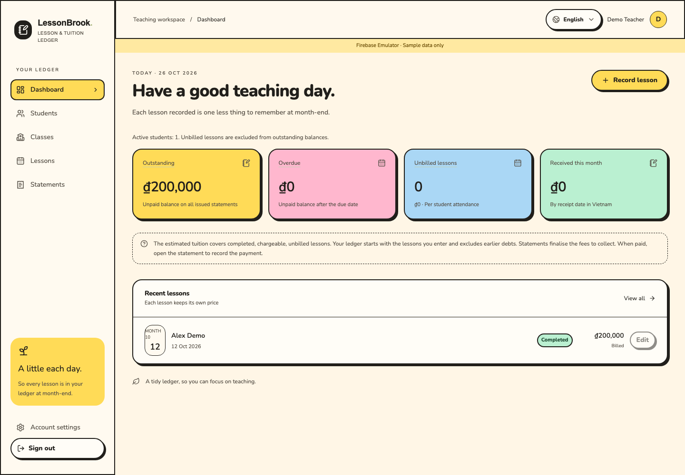

# LessonBrook

**English** | [Tiếng Việt](README.vi.md)

[](https://github.com/devoralabsapp/lessonbrook/actions/workflows/ci.yml)

**Project status:** early-stage public source release. See [maintainers and maintenance process](MAINTAINERS.md), the [roadmap](ROADMAP.md), and the [changelog](CHANGELOG.md). External adoption has not yet been established.

A lesson and tuition ledger for independent teachers, supporting individual lessons, groups, and classes billed after each lesson. Run it locally, self-host it, or fork it to fit your workflow. Released under the [MIT License](LICENSE).

Repository documentation defaults to English. The application interface is currently in Vietnamese, with VND amounts and Vietnam business dates.

## Preview



English interface preview · Playful Retro Neo-Brutalism · Fictional sample data captured locally with Firebase Emulator. The community edition UI is currently Vietnamese.

## Features

- Google sign-in; HttpOnly server sessions, revocation checks, CSRF and Origin protection.
- Students, default rates, archiving/restoring, classes of up to 50 students, and group lessons with saved price snapshots.
- Per-student statements, issue/void workflows, partial payments, and voiding incorrect payment records.
- Expiring and revocable statement links; dashboard, search, filters, CSV/ZIP/JSON export, and account deletion.
- Eight themes: Modern, Vintage, Art, Natura, Ocean, Command Line, Visual Code, and Playful Retro Neo-Brutalism, with mobile-friendly layouts. Command Line uses black panels and green accents. Playful Retro adds cream, yellow/pink/blue/mint cards, bold outlines, hard shadows, pill controls and self-hosted Nunito (SIL OFL 1.1). Select any theme in account settings for an instant preview; only Save appearance persists it. Cancel preview, leave settings or reload to discard an unsaved choice.

All business reads and writes go through Node server APIs. The Firebase client is used only for Auth; Firestore Rules deny direct client access. Tuition data is not stored offline.

## Quick start

Install **Node.js 24.x**, npm, **Java 21**, and Git. The Node version is specified in `.nvmrc`. On macOS, choose the matching Intel (`x86_64`) or Apple Silicon (`arm64`) binary. If needed, select Java with `export JAVA_HOME="$(/usr/libexec/java_home -v 21)"` and add `$JAVA_HOME/bin` to PATH. On Windows, you can use WSL with tools installed inside WSL.

```bash
git clone https://github.com/devoralabsapp/lessonbrook.git
cd lessonbrook
npm ci
test -e .env.local || cp .env.example .env.local
npm run emulators
```

Wait for **All emulators ready**, then open a second terminal in the same directory:

```bash
npm run dev
```

Open **http://localhost:3000**. Use `localhost` exactly: APP_ORIGIN and the Auth Emulator relay depend on the same hostname. The Google sign-in button opens the **Firebase Auth Emulator**, not real Google OAuth. Create a fake account and use test data only.

You do not need a Google Cloud account, a real Firebase project, a service-account key, or Vercel for local use. `.firebaserc` defaults to `demo-chotcong`. The first run needs network access to download emulator/browser binaries.

### Sample data

With the emulators ready, open a third terminal:

```bash
npm run seed
```

In the Google Emulator, choose **Add new account** and use the fake email `mai@example.test`. The sample ledger contains student Lan, eight completed lessons at VND 200,000 each, and one cancelled lesson. Seeding is idempotent. Guards reject real projects and non-loopback hosts.

Emulator UI: http://localhost:4100. When stopped with Ctrl+C, the emulators export data to `emulator-data/` and import it automatically on the next start. This directory stays on your machine and is ignored by Git. See the [local backup rehearsal](docs/BACKUP_RESTORE.md) to try encrypted backups and restores with fake data.

Default ports: 3000 (web), 9099 (Auth), 8180 (Firestore), 4100 (UI), 4400/4500 (hub/logging), and 9150 (websocket). Stop only processes you own when resolving a port conflict; another Firebase project may use the same ports.

## Checks

```bash
npm run lint
npm run typecheck
npm test
npm run build
npx playwright install chromium
npm run test:emulator
```

Stop this project's web server and emulators before `test:emulator`. The runner starts a demo environment, builds with Webpack, runs backend/Rules/Playwright checks, and cleans up its processes. Do not point tests or seed scripts at cloud projects. CI uses Node 24 and Java 21 without cloud credentials.

Development and production builds both use Webpack. `typecheck` runs Next type generation before TypeScript. Version-matched framework documentation is available in `node_modules/next/dist/docs/`.

## Self-hosting

Read [DEPLOYMENT](docs/DEPLOYMENT.md). You need your own Firebase project, Google provider, database/Rules/indexes, HTTPS hostname, and IAM permissions. The source supports Vercel OIDC/WIF to avoid private keys. Cloud scripts are templates: configure and review their targets before using them with real data.

This public edition is independent of any existing deployment. It excludes account data, actual environment files, private Git history, operational screenshots, and another deployment's cloud identifiers. Deploying the app does not by itself verify Google OAuth, IAM, HTTPS cookies, cloud indexes, or installation on real devices.

## Development

See [ARCHITECTURE](docs/ARCHITECTURE.md), [CONTRIBUTING](CONTRIBUTING.md), and [SECURITY](SECURITY.md). Amounts are integer VND and business dates use Asia/Ho_Chi_Minh. Preserve price snapshots, transaction idempotency, and `billedStatementId` locks when changing business logic.

The MIT License covers the project's source code. Dependencies retain their own licenses; no rights to third-party services or accounts are included. Names and emails in seeds and fixtures are fictional.
